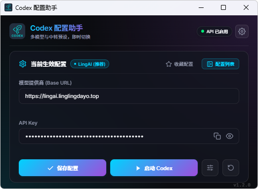

# Codex 配置助手 (Codex Config Manager)

<p align="center">
  <b>专为 Codex / ChatGPT 桌面端设计的轻量级配置中转与进程管理工具</b>
</p>

<p align="center">
  
  
  
  
  
  
</p>

<p align="center">
  
</p>

---

## 📖 项目简介

**Codex 配置助手** 是一款专为 Codex (ChatGPT) 桌面客户端打造的高效辅助工具。采用超紧凑窗口设计（520 × 350 px），旨在以极低系统资源占用提供中转站预设切换、模型参数调整与客户端启动调度能力。

核心设计严格遵循**非破坏性配置修补**与**环境隔离**原则，保障外部应用配置的安全稳定。

---

## ✨ 核心特性

- ⚡ **当前生效配置管理**：查看与修改 Base URL 和 API Key，支持一键复制密钥、自动规范化地址及智能识别配置变更。
- 🚀 **进程调度与一键拉起**：一键启动或重启 Codex 客户端，启动前自动保存配置并检测进程退出状态。
- 📑 **多中转站配置库**：内置多套默认中转方案，支持拖拽排序、一键切换及编辑高级模型参数。
- 🎛️ **次级扩展配置抽屉**：按需配置模型名称、思考强度动态档位及模型显示别名，保持主界面简洁。
- ⚙️ **系统级偏好设置**：全屏沉浸式设置弹窗，支持中转站快捷标签开关与客户端真实安装路径检测。
- 🛡️ **非破坏性 TOML 修补**：写入 `config.toml` 时仅增量修改目标字段，完整保留原有注释与结构。
- 🔄 **一键安全重置**：配备二次确认弹窗，一键恢复为官方默认配置并清除自定义鉴权。
- 🧪 **环境与数据严格隔离**：非 Release 环境下自动读写 `_dev` 配置文件，避免污染生产数据。

---

## 🏛️ 领域概念与架构规范

本项目对领域概念执行严格的分离规范：

| 维度 | 配置 (Config) | 设置 (Settings) |
| :--- | :--- | :--- |
| **管理对象** | 外部应用 (Codex) 的运行参数 | 本管理工具自身的系统偏好与运行时行为 |
| **涵盖范围** | API Key、Provider URL、自定义 Model、中转预设 | 客户端可执行文件路径、自动拉起与重启行为 |
| **存储载体** | `~/.codex/config.toml` 与 `~/.codex/auth.json` | `~/.codex/settings.json` |
| **交互载体** | 主卡片与 80% 高度「更多配置」抽屉 | 100vw × 100vh 全屏模态「设置」弹窗 |

---

## 🛠️ 技术栈

- **桌面内核**：[Tauri 2](https://v2.tauri.app/) (Rust)
- **前端视图**：[Vue 3](https://vuejs.org/) (Composition API, `<script setup>`)
- **开发语言**：TypeScript / Rust
- **构建工具**：[Vite](https://vitejs.dev/)
- **样式方案**：Sass (SCSS) 模块化，极简桌面暗黑设计
- **测试框架**：[Vitest](https://vitest.dev/) (前端) + Cargo Test (Rust)

---

## 📂 目录结构

```text
codex-config-manager/
├── src/                          # 前端源码 (Vue 3 + TypeScript + Sass)
│   ├── components/               # 配置卡片、设置弹窗等 UI 组件
│   ├── composables/              # 配置读写、预设管理与进程调度逻辑
│   └── styles/                   # 极简暗黑主题与全局样式
├── src-tauri/                    # 桌面端后端 (Tauri 2 + Rust)
│   ├── src/                      # 系统进程探测、TOML 安全修补与 IPC 指令
│   └── tauri.conf.json           # 桌面端窗口与权限配置
├── release/                      # 构建产物发布目录 (安装包与可执行程序)
├── scripts/                      # 发布自动化与日志解析脚本
└── assets/                       # 项目预览与展示资源
```

---

## 🚀 快速上手

### 1. 环境准备

确保本地已就绪以下开发环境：

- [Node.js](https://nodejs.org/) (`v18+` 或 `v20+`)
- [Rust](https://www.rust-lang.org/) (建议最新稳定版，通过 `rustup` 安装)
- 操作系统对应的 [Tauri 2 前置依赖](https://v2.tauri.app/start/prerequisites/)

### 2. 安装依赖

```bash
npm install
```

### 3. 开发与调试

启动完整桌面端开发环境（同时拉起 Vite 与 Tauri 窗口）：

```bash
npm run tauri dev
```

如仅需在浏览器中调试前端页面样式：

```bash
npm run dev
```

### 4. 自动化测试

运行全部单元测试套件：

```bash
# 执行全部测试 (前端 Vitest + 后端 Cargo)
npm run test:all

# 仅执行前端单元测试
npm run test

# 仅执行 Rust 后端测试
npm run test:rust
```

### 5. 构建打包

生成生产环境安装包或绿色可执行程序：

```bash
# 完整构建并自动归档到 release 目录
npm run tauri build
# 或使用快捷别名
npm run build:app
```

构建完成后，自动化脚本会自动将对应版本的安装包（`.exe`、`.msi`，采用英文包名）及便携版程序复制至根目录的 `release/` 目录（同名文件自动覆盖）。

如需单独手动执行归档复制：
```bash
npm run release:copy
```

---

## 📄 配置文件机制与映射

工具针对目标应用与自身运行时状态分别采用独立存储，并实现开发与生产环境隔离：

| 配置类型 | 生产环境路径 | 开发环境路径 | 说明 |
| :--- | :--- | :--- | :--- |
| **目标应用配置** | `~/.codex/config.toml` | `~/.codex/config_dev.toml` | Codex 运行参数，采用增量安全修补 |
| **目标应用鉴权** | `~/.codex/auth.json` | `~/.codex/auth_dev.json` | API Key 鉴权凭证 |
| **中转站预设库** | `~/.codex/presets.json` | `~/.codex/presets_dev.json` | 用户保存的多套中转站方案 |
| **应用系统设置** | `~/.codex/settings.json` | `~/.codex/settings_dev.json` | 客户端路径选择与拉起偏好 |

---

## 📜 许可协议

本项目遵循 MIT 开源许可协议。
